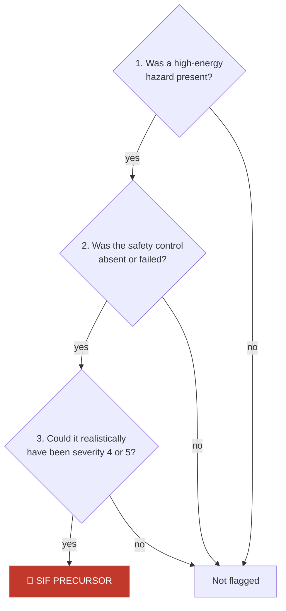
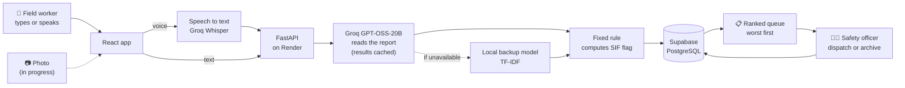

<div align="center">

# 🚨 SANKET

### AI that reads safety reports and spots the ones that could have killed someone.

*It never closes a report. It only changes the order they are read in.*


**Team Signal-0 · PS SIH26165 · Oil India Limited**

### 👉 [Try the live prototype](https://sanket-frontend.onrender.com) · [API docs](https://sanket-backend-put3.onrender.com/docs)

<sub>Free hosting sleeps when idle. The first load can take up to a minute.</sub>

</div>

---

## 💡 The problem

Safety teams count incidents. But a near-miss where someone *almost* died looks like a
non-event on paper, and serious warnings sit in the same pile as routine reports.

**SANKET finds the warnings and moves them to the top.**

## 🧠 How it works

A worker types or speaks a report. The AI asks three plain questions, and a **fixed rule**
(never the AI's opinion) decides the flag.



Unclear reports are not flagged, but their severity still ranks them high in the queue
so a person reads them. A safety officer then reviews the ranked list, reads the AI's
reasoning, and chooses to **dispatch** or **archive**. The AI never decides.

## 🏗️ Architecture



## 🖥️ Screens

| Page | For | What it does |
|---|---|---|
| `/worker/report` | Field worker | Speak or type a report, add site, activity and shift |
| `/admin/triage` | Safety officer | Ranked queue with Active, Dispatched and Archived tabs |
| `/admin/dashboard` | Management | Risk by site and activity |

No login. The role is picked on the home page for demo purposes.

## 🧭 Project status

**8 of 10 core features are built.**

| Status | Feature |
|---|---|
| ✅ Built | Text reports |
| ✅ Built | Voice reports (recorded in the browser, turned into text) |
| ✅ Built | AI classification with written reasoning |
| ✅ Built | Fixed-rule SIF flag |
| ✅ Built | Backup model when the main AI is unavailable |
| ✅ Built | Ranked triage queue |
| ✅ Built | Dispatch and archive, saved to the database |
| ✅ Built | Analytics dashboard (risk by site and activity) |
| 🔨 In progress | **Photo input.** A vision model (Qwen, hosted on Groq) turns a photo into a written description, which then goes through the same three questions |
| 🔨 In progress | **Location history in the officer's review.** Shows past precursors at the same site. The site data is already collected; the review screen and scaling are still being built |

**Next steps**

- Grow the labelled set from 180 to about 1,000 reports
- Test on real Oil India incident records (needs access)
- Set up each company's own safety rules for a wider rollout

## 🚀 Run it locally

```bash
git clone https://github.com/sukanya-2006/SANKET.git && cd SANKET
python -m venv .venv && source .venv/bin/activate     # Windows: .venv\Scripts\activate
pip install -r backend/requirements.txt
cd backend && uvicorn app.main:app --reload --port 8000

# second terminal
cd frontend && npm install && npm run dev
```

The backend works with no keys or database, using 180 built-in sample reports.
For the real AI and database, add `backend/.env`:

```
GROQ_API_KEY=...
SUPABASE_DB_URL=postgresql://...
```

Then open `http://127.0.0.1:8000/health` to see which model and database are actually in use.

## ✅ What is real, and what is not

- **Data:** 150 reports written for the prototype plus 30 real public OSHA reports, each
  labelled by two reviewers against one written rubric ([`docs/rubric.md`](docs/rubric.md)).
  No Oil India data has been used.
- **Backup model:** F1 0.754 ± 0.077 (5-fold cross-validation, 114 reports).
- **Photo input** is not live yet. Everything else in the diagram above is.
- **No login.** Roles are a demo convenience, not access control.

## 📁 Repo map

`backend/` API and classifier · `frontend/` React app · `docs/` rubric and notes · `data/` reports and labels